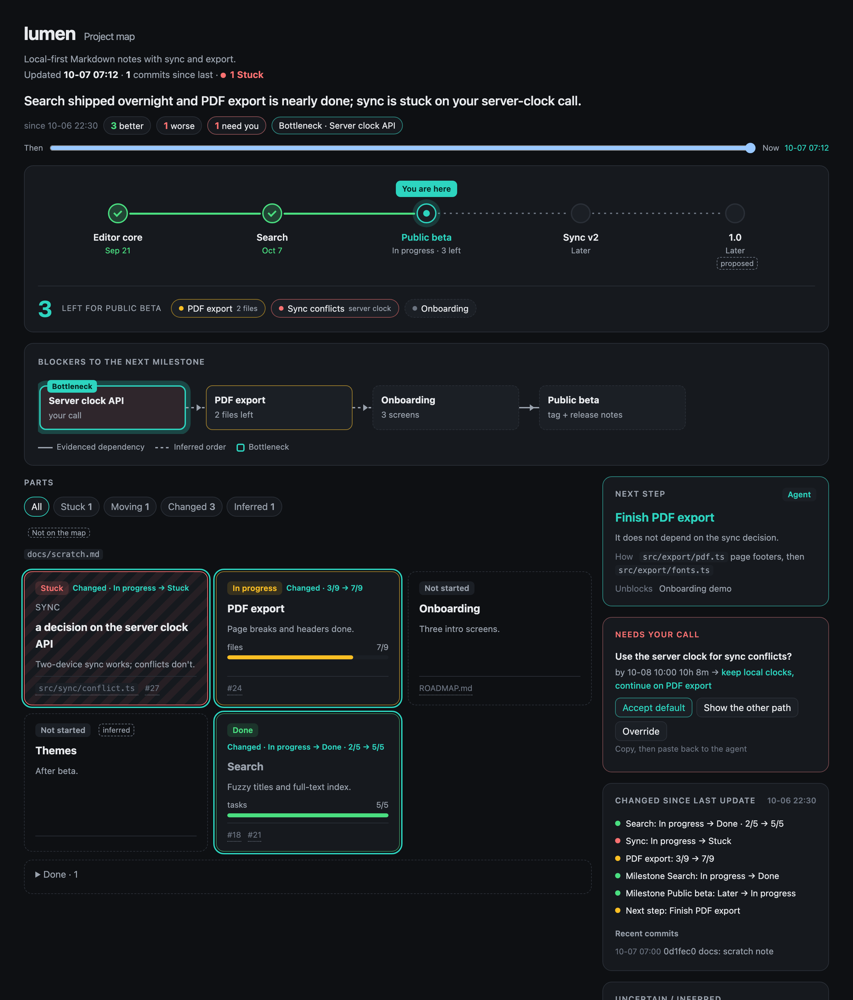

# you-are-here

> Let your coding agent work overnight. In the morning, open one page and see where the project is.

`you-are-here` is an agent skill that draws a one-file HTML map of a git project:

- a milestone track with a "you are here" marker;
- the blocker chain to the next milestone;
- a status card for each part of the project;
- the next step, and decisions that wait for you, each with a default;
- what changed since the last map.



<sub>Demo data from a fictional project. Rebuild it with `python3 docs/demo/build.py`.</sub>

It works with any agent that reads `SKILL.md` and can run shell commands. Claude Code and Codex CLI
have drawn maps with it end to end. Grok CLI loads it, but on a machine whose Claude hooks reject
Grok's shell tool (Grok runs Claude hooks by default), its shell commands are denied. See Troubleshooting.

## How it is split

| Who | Does what |
|-----|-----------|
| `scripts/pmap.py` (Python 3.8+, stdlib only) | collects git / GitHub facts, computes the delta since the last map, validates `map.json`, diffs against the previous map, renders the HTML |
| the agent | decides the parts, statuses, milestones and blocker chain, and writes `map.json` ([schema](references/schema.md)) |

The fixed page structure keeps maps consistent across agents and runs. Incremental mode keeps
updates cheap. `collect` compares against the last rendered map and reports a delta:
- new commits and uncommitted edits, mapped onto each part's `paths`;
- PRs opened, merged or changed, issues, and new CI runs.

The agent only re-checks what the delta names. `render` lists what changed: part status and
progress, milestones, the bottleneck, chain nodes, remaining items and the next step.

## Install

```sh
python3 install.py --dry-run --all   # show what would change
python3 install.py --all             # skills + background subagents + automation rules
python3 install.py                   # skills only
python3 install.py --uninstall       # remove everything it installed
```

| Part | Claude Code | Codex | Grok |
|------|-------------|-------|------|
| skill (symlink) | `~/.claude/skills/you-are-here` | `~/.codex/skills/you-are-here` | `~/.agents/skills/you-are-here` |
| background subagent | `~/.claude/agents/you-are-here.md` (always background, effort medium, skill preloaded) | `~/.codex/agents/you-are-here.toml` (effort medium) | `~/.grok/agents/you-are-here.md` |
| automation rule | `~/.claude/rules/you-are-here.md` | marked block in `~/.codex/AGENTS.md` (backed up first) | reads `~/.claude/rules` via Claude compat |

The installer only touches its own files: symlinks to this folder, files carrying its marker, and
the marked block in `AGENTS.md`. It skips anything else that already exists.

## Use

Ask your agent for a project map, for example "draw a project map for this repo" or
`/you-are-here`. Output goes to `<repo>/.project-map/index.html`. That folder ignores itself, so
the repo's own `.gitignore` is untouched.

Manual use:

```sh
python3 scripts/pmap.py style --theme dark --accent '#2dd4bf' --lang zh   # once per machine
python3 scripts/pmap.py collect /path/to/repo      # -> .project-map/facts.json
# agent (or you) writes .project-map/map.json
python3 scripts/pmap.py render /path/to/repo       # -> .project-map/index.html
python3 scripts/pmap.py status /path/to/repo       # none | fresh | stale
```

The style is stored in `~/.config/you-are-here/style.json` and shared by every agent.

## Background and automation

The rule (`rules/you-are-here.md`) tells the agent to:

- start the `you-are-here` subagent in the background before a long unattended run;
- after each milestone, run `pmap.py status`. It is git-only, needs no network or model, and prints
  `none`, `fresh` or `stale`. Re-draw the map in the background when it is stale;
- answer "where are we?" from `map.json` when the map is fresh;
- put choices that need you into `decisions` with a default and a deadline, and go ahead with the
  default only for reversible, local choices.

## Troubleshooting

- **Grok: "Hook denied: … accepts Bash hook events only".** Grok runs Claude Code hooks by default
  (`[compat.claude] hooks`). A Claude hook that only understands Claude's `Bash` tool then rejects
  Grok's shell tool. Fix the hook or its Grok adapter, or turn off `compat.claude.hooks` for Grok.
  The skill tells agents to stop and report this and never to edit hook config themselves.

## Tests

```sh
python3 -m unittest discover -s tests
```

## License

MIT
