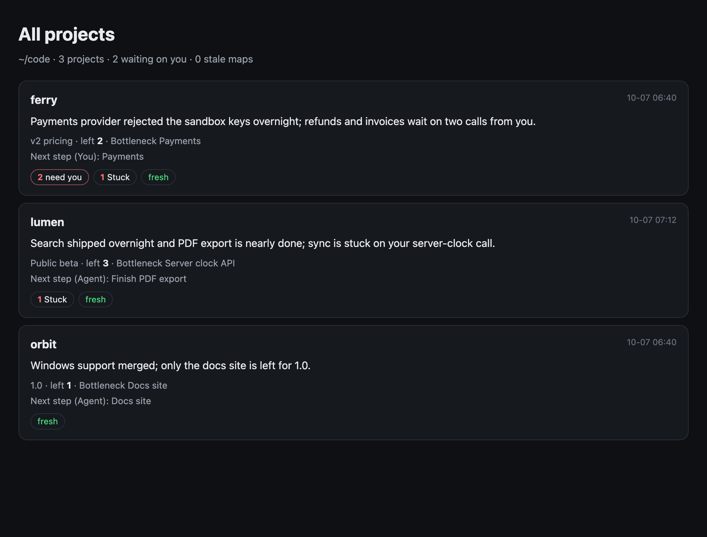

# you-are-here

> Let your coding agent work overnight. In the morning, open one page and see where the project is.

`you-are-here` is a plugin for **Claude Code, Codex and Grok** that keeps a one-file HTML map of
a git project:

- one sentence on what changed since the last map, plus counts of what got better, what got worse
  and what needs you;
- a milestone track with a **you are here** marker, and the blocker chain to the next milestone
  with the bottleneck marked;
- a card per part of the project: done, in progress, stuck (and what it waits on), not started;
- the next step, who does it (you or the agent), how, and what it unblocks;
- decisions that wait for you, each with a default you can accept or override;
- a slider to replay the night, filters, and links back to the PRs, commits and files behind
  every claim.


<sub>Demo data from a fictional project. Rebuild it with `python3 docs/demo/build.py`.</sub>

The page is a single file with no network access: double-click it, or keep it open and refresh.

## Install

### Claude Code

```text
/plugin marketplace add majiayu000/you-are-here
/plugin install you-are-here@you-are-here
```

### Codex

```sh
codex plugin marketplace add majiayu000/you-are-here
codex plugin add you-are-here@you-are-here
```

Then open `/hooks` in Codex once and trust the you-are-here hooks (until you do, Codex skips them).
Codex plugins can't ship subagents, so add the background subagent from a checkout:

```sh
git clone https://github.com/majiayu000/you-are-here && python3 you-are-here/install.py --codex-agent
```

### Grok

```sh
grok plugin marketplace add majiayu000/you-are-here
grok plugin install you-are-here --trust
```

### Skill only

To use only the skill, without hooks or the subagent, link
`plugins/you-are-here/skills/you-are-here` into your agent's skills folder, or run
`python3 install.py`.

## Use

Talk to your agent:

- "Draw a project map for this repo" / "画个项目地图": draws the first map into
  `.project-map/index.html`. That folder ignores itself, so the repo's `.gitignore` is untouched.
- "Where are we?" / "进度到哪了": the agent answers from the map, and refreshes it first when it is
  out of date.
- "Keep working on this overnight": the agent draws the map first and offers to turn on automatic
  refreshes.

- "How are all my projects doing?": `pmap.py index ~/code` writes one page over every repo that
  has a map, with the ones waiting on you first.

  

When you answer a decision (in chat, or by pasting what the page's Accept / Override buttons copy),
the agent records it with `pmap.py answer`. Every agent and every background refresh then sees the
answer, and the page marks the decision answered.

Automatic refreshes are off until you turn them on for a repo:

```sh
python3 <plugin>/skills/you-are-here/scripts/pmap.py auto on .   # or ask the agent to do it
```

## How it stays up to date

| When | What the plugin does |
|------|----------------------|
| A session starts | Gives the agent a few lines from the map: headline, bottleneck, next step, open decisions, and whether the map is stale |
| You ask "where are we?" | Tells the agent to answer from the map, or to refresh it first |
| You start a long unattended run | Tells the agent to draw or refresh the map and offer `auto on` |
| After `git tag`, `git merge`, `gh pr merge` or `gh release create` (a plain commit or push is not a milestone) | Checks whether the map is stale. With auto on, it starts a background refresh; otherwise it nudges the agent once |
| At the end of each turn | With auto on and a stale map, starts a background refresh |

"Stale" is decided by git alone, with no network and no model: a single new commit, a new tag, or
one edited, deleted or untracked file since the last map. Automatic refreshes still respect their
interval limit. Incremental collection includes new, uncommitted modules in its unmapped paths.

Grok passes hook output to the model only after tool calls and at the end of a turn, so in Grok the
map summary is not handed over at session start and "where are we?" goes through the skill. The
milestone checks and background refreshes work the same way as in the other two agents.

A background refresh runs the same agent you are using, headless and detached: `claude -p`,
`codex exec` or `grok -p`. It is limited to one at a time per repo and to one every 20 minutes
(`auto on --every 30` changes that). It writes only inside `.project-map/` and logs to
`.project-map/bg.log`. When it finishes, you get a desktop notification (macOS, or `notify-send` on
Linux) if a part got worse, a new decision needs you, or the refresh failed. After a failure the
next try waits twice as long each time (up to 6 hours); after 5 failures in a row, refreshes pause
until you run `auto on` again. You get one notification for the first failure and one when they
pause, with the reason (for example, that the agent CLI is not logged in). In Claude Code and Grok
you can also start the `you-are-here` subagent in the background from inside a session.

## Rules the map follows

The same rules apply in every agent, so maps from Claude, Codex and Grok look and read the same.

- The repo is read-only. The plugin and the agent write only `.project-map/`.
- Every claim on a card links to evidence (a PR, a commit, a file, a CI run) or is marked
  *inferred*. Milestones the repo doesn't define are marked *proposed*.
- **Done** means merged with nothing known left to verify. Previous verification remains evidence
  until contradicted; missing a fresh check does not reopen completed work. A **bottleneck** needs
  an evidenced dependency on the goal. When no next goal is established, the map says so.
- Remaining items have stable IDs. Renaming or removing one does not count as completion; only
  an explicit move to `done` does. A change in a progress count's unit is shown separately.
- The header explains what the project does. The milestone track sits above all module cards;
  completed modules stay visible in their original positions. Click a card for full details and
  evidence. The next action leads the right column on desktop and comes first on mobile.
- Replay preserves next steps, bottlenecks and decisions, even when no part changed status.
  Re-rendering the same content preserves its last change highlights, including after styling edits.
  Dependencies, commit history and uncertainties start collapsed.
- `status` is a Git-only freshness check. The page shows separate Git and GitHub collection
  times; current PR/CI claims require another collection even if Git is fresh.
- A decision only goes ahead on its own when it is reversible and local, and it shows a countdown.
  Merges, pushes, releases, deletions and spending always wait for you.
- If a hook or permission policy blocks a command, the agent stops and reports it. It never edits
  hook or permission settings to get around a block.

## What reads into the map

- git: commits (including the upstream branch), tags, branches, and uncommitted edits;
- GitHub (optional, through `gh`, read-only): open issues, open PRs with their checks and review
  state, and CI runs on the default branch;
- plan files the project already keeps: spec-kit and Kiro `tasks.md`, Taskmaster `tasks.json`,
  Codex ExecPlans (`PLANS.md`), and checklists in `TODO.md` or `ROADMAP.md`.

`scripts/pmap.py` (Python 3.8+, stdlib only) collects these facts, diffs them against the last map,
validates what the agent writes and renders the page. The agent supplies the judgment: what the
parts are, where they stand, and what blocks what.

## Compared with

| | you-are-here | [project-artifact](https://github.com/anthropics/claude-plugins-official/tree/main/plugins/project-artifact) | Taskmaster / spec-kit | Agent dashboards (Agent View, `/goal`) |
|---|---|---|---|---|
| Shows | where the **project** is | where the project is | the task list | what the **agent session** is doing |
| Agents | Claude Code, Codex, Grok | Claude Code | many | one each |
| Output | local single HTML file | page on claude.ai (needs login) | JSON / Markdown | in-app view |
| Updates during unattended runs | yes (hooks, background refresh) | when asked | when the agent edits tasks | live |
| Decisions with defaults | yes, reversible only | no | no | no |
| Diff since the last map | yes, on the page | summary in chat | no | no |

you-are-here reads Taskmaster and spec-kit task files when a project has them; it is a view over
those plans, not a replacement for them.

## Troubleshooting

- **Grok: "Hook denied: … accepts Bash hook events only".** Grok runs Claude Code hooks by default
  (`[compat.claude] hooks`). A Claude hook that only understands Claude's `Bash` tool then rejects
  Grok's shell tool. Fix that hook, or turn off `compat.claude.hooks` for Grok. you-are-here tells
  agents to stop and report this, never to edit hook config.
- **Background refresh did nothing.** Read `.project-map/bg.log`. Refreshes run only after
  `pmap.py auto on`, only when `pmap.py status` says `stale`, and at most once per interval.
  `.project-map/refresh-result.json` holds the last failure, how many in a row, and when the next
  try may start.
- **"CLI is not logged in".** Background refreshes use the standalone CLI (`claude`, `codex`,
  `grok`), which keeps its own login apart from the desktop apps. Log in once in a terminal (for
  example `claude auth login`), then run `pmap.py auto on .` to retry right away.
- **Debugging hooks.** Set `YAH_DEBUG=1` to log what each hook received and returned to
  `~/.cache/you-are-here/hook.log`.

## Development

```sh
python3 -m unittest discover -s tests   # 40+ tests, including fake agent CLIs for the hooks
python3 docs/demo/build.py              # rebuild the demo page and screenshot
```

Inspired by [@Voxyz_ai's project-map subagent idea](https://x.com/Voxyz_ai/status/2107455844992299272).

## License

MIT


### Token usage

When requested, `scripts/session_stats.py` counts one Claude source session (including retained
subagent logs) and one selected Codex Skill invocation. The page adds only two token totals with
collapsed accounting details. Statistics come from a local script, without a model rereading the
conversation. Ordinary map updates do not perform deep conversation analysis. See the skill's
“Optional token usage” section for the command and boundaries.
The current total is dated and matched to the map's collection time. A later collection without
matching usage shows “Unavailable”; the prior invocation remains dated in the details.
